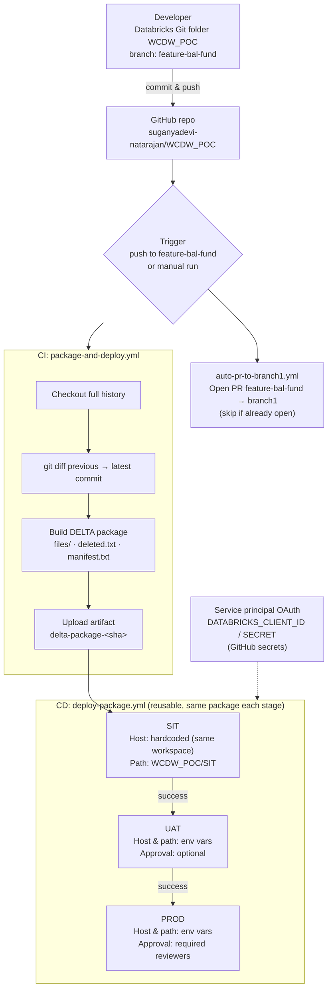

# WCDW_POC
POC for implementing GITHUB in WCDW project

## CI/CD flow

Each deploy stage: set environment details → download package → install Databricks CLI → import changed files (overwrite) → delete removed files.

### Bundle targets (`databricks.yml`)

| Target | Mode | Deploy location |
| --- | --- | --- |
| dev | development | `~/.bundle/wcdw_poc/dev` |
| sit | production | `WCDW_POC/SIT` (same workspace as dev) |
| uat | production | `~/.bundle/wcdw_poc/uat` |
| prod | production | `~/.bundle/wcdw_poc/prod` |
